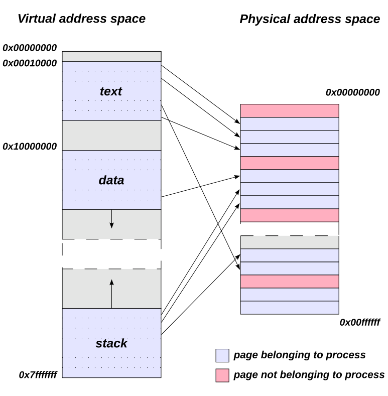
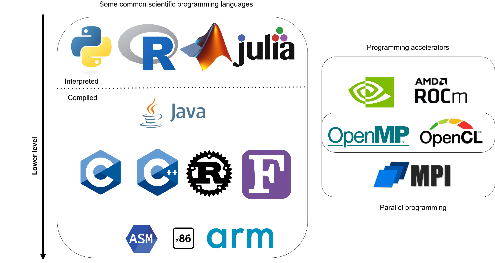

# Segmentation faults

## Segmentation faults

- A **segmentation fault** occurs when a program accesses memory it **does not own**.
- Common causes:
  - Dereferencing **NULL** or **uninitialized pointers**
  - Accessing memory **out of bounds** (arrays, strings)
  - Writing to **read-only memory**

## Segmentation fault example {.smaller}

```{.c .small-code}
#include <stdio.h>
 
int main(void) {
    int n = 4;
    int A[n];
    for (int i = 0; i <= n; i++) printf("A[%5d] = %12d\n", i, A[i]);
    for (int i = 1; i <= n; i++) printf("A[%5d] = %12d\n", i * 30000, A[i * 30000]);
    return 0;
}
```

What will happen when you compile and run this program?

- The program will not compile
- The program will crash when accessing `A[0]` since its value is not initialized
- The program will crash when accessing `A[4]` since it is outside of the array
- The program *might* crash when accessing any element outside of the array
- The program will always run to completion

## Segmentation fault example {.smaller}

Invalid array access gives undefined behavior, the result can depend on the system

```{.bash}
A[    0] =            0
A[    1] =            0
A[    2] =      4199005
A[    3] =            0
A[    4] =  -2103564768
A[30000] =   1818850658
A[60000] =    774974819
Segmentation fault (core dumped)
```

- Some elements of the array (`A[2]`) have a *garbage* value
  - Makes sense, elements were not initialized
- Some elements outside of array (`A[30000]`) have a garbage value
  - Makes sense, you just get what happens to be in memory at `(A + 30000)`
- The access of `A[90000]` gives a segmentation fault
  - ???

## Virtual vs physical memory {background-color="lightgrey" .smaller}

:::: {.columns}
::: {.column width=65%}
- As a user/programmer, you see *virtual* memory
- Virtual memory creates the illusion of a large, contiguous, uniform address space
  - Hides fragmentation of physical memory
  - Delegates managing memory hierarchy (caches, RAM, disk) to OS
  - Provides safety mechanism to isolate process' address space
:::
::: {.column width=35%}
 
:::
:::: 

::: {.fragment}
- Mapping to physical memory in page table
  - Out-of-bounds memory access can pick up garbage mapping address
  - You might be accessing another process' memory, even on read access the CPU throws a segmentation fault
:::

## Segmentation fault example {.smaller}

Invalid array access gives undefined behavior, the result can depend on the system

```{.bash}
A[    0] =            0
A[    1] =            0
A[    2] =      4199005
A[    3] =            0
A[    4] =  -2103564768
A[30000] =   1818850658
A[60000] =    774974819
Segmentation fault (core dumped)
```

- Some elements of the array (`A[2]`) have a *garbage* value
  - Makes sense, elements were not initialized
- Some elements outside of array (`A[30000]`) have a garbage value
  - Makes sense, you just get what happens to be in memory at `(A + 3000)`
- The access of `A[90000]` gives a segmentation fault
  - This virtual address corresponds to a physical address that is not part of the process
  - The operating system reports this as a segmentation fault


## Handling segmentation faults

- Do not make coding mistakes :)
- Ask the compiler to instrument executable to 
  - `gcc -fsanitize=bounds-strict segmentation_fault.c`
  - Can lead to lower performance
- Run the program under a debugger such as `gdb`
  - Compile with debug symbols (`-g`)

# Versions of C

## Versions of C ^[Adapted from https://github.com/gjbex/Scientific-C]

## A brief history of C

- C development starts in the early 1970s
- First standard published in 1989: ANSI C or C89
- Update in 1999: C99 standard
- Update in 2011: C11 standard
- Minor bugfixes in 2017: C17 (sometimes referred to as C18)
- Update in 2023: C23

## Different C standards

- The C89 standard is still considered the default
- Compiler has to be instructed to use specific standard: `gcc -std=c11`
  - You need a recent compiler for the most recent standard
- Compilers often do not stick *exactly* to standard
  - `gcc` provides some C99 constructions by default
  - Options like `-std=c89 -pedantic` make it more strict

## The C99 standard additions {.smaller}

- Single-line comments with `//`
- Variable length arrays
- Mark functions with `inline` to avoid call overhead
- Use `restrict` to indicate arrays do not overlap
- Boolean and complex types in `<bool.h>` and `<complex.h>`
- Type-generic macros in `<tgmath.h>`
- IEEE 754 floating point support

## Inline functions {.smaller}

- Function call: expensive
  - call stack must be maintained
  - stack variables allocated, initialized
- Small functions, called often: lots of overhead
- Inline functions: function code inserted in caller
  - good compilers try that anyway
  - helping compilers: better optimization!

```{.c}
inline double sqr(double x) {
    return x*x;
}
```

## Restrict keyword for arrays

- Arrays in C:
  - decay into pointers, just contain address of first element
  - no semantics for compiler
- Multiple arrays as function arguments, do they overlap?
- Help compiler, use `restrict`
  - programmer assures to compiler that arrays don't overlap

```{.c}
void daxpy_r(double * restrict z, double a, double * restrict x,
             double * restrict y, int n);
```

## Complex numbers

- Types:
  - float complex: single precision
  - double complex: double precision
  - long double complex: extended precision
- Declarations in complex.h
  - types
  - literal: I
  - functions, e.g., `creal`, `cimag`, `csqrt`, `cexp`, ...

## Type-generic math {.smaller}

- Automatically selects the correct version of a math function:
  - `float`, `double`, or `long double`
  - `complex` or `real` types
- Cleaner code: No need to manually choose `sinf`, `sin`, or `sinl`.
- Type safety: Matches function to argument type at compile time.

```{.c}
#include <tgmath.h>

double x = 0.5;
float y = 0.5f;

double result1 = sin(x);  // uses sin()
float result2 = sin(y);   // uses sinf()
```

## IEEE 754 floating point support 

- float: 4 bytes, single precision
- double: 8 bytes, double precision
- long double: 12 bytes, extended precision
- Rounding well-defined
- Support for Inf, -Inf, NaN 

## The C11 standard

The `_Generic` Keyword

- Enables **type-generic programming** (like `tgmath.h`)
- Example:
  ```c
  #define my_abs(x) _Generic((x), \
      int: abs, \
      float: fabsf, \
      double: fabs \
  )(x)
  ```

## Mathematics in C23

- New mathematical functions in `math.h`
  - `sinpi(x)` is the same as `sin(pi*x)` with better precision
  - `exp10` et al.
- Checked integer arithmetic in `stdckdint.h`
  - `ckd_add` et al.
- Support for `1'000` and `1'133.023` notation
- Decimal floating-point math (IEEE 754-2008/2019)

## Syntax changes in C23

- `nullptr` (keyword) rather than `NULL` (macro)
- `true/false` keywords, `stdbool.h` not required
- Unnamed function parameters
- `stdbit.h`: bit manipulation functions
- `strdup/strndup`: simple string duplication
- `constexpr` for compile-time constants
- `static_assert` for compile-time asserts
- `typeof` to determine type at compile time

## C23 attributes {.smaller}

- Defensive programming
  - `[[fallthrough]]`: intentional fall-through in switch
  - `[[nodiscard]]`: don't ignore return value
  - `[[maybe_unused]]`: don't warn if not used (function/parameter)
  - `[[deprecated]]`
- Performance related
  - `[[unsequenced]]`: function has no side-effects, calls can be out-of-order
  - `[[reproducible]]`: function has no side-effect, calls have to be in-order (e.g., random numbers)

# Wrapping up

## Scientific programming landscape



## More to explore

- How to do HPC => [HPC intro](https://hpcleuven.github.io/HPC-intro) and [Linux for HPC](https://hpcleuven.github.io/Linux-for-HPC/)
- Build systems => [CMake intro](https://hpcleuven.github.io/CMake-intro/) and [Makefile intro](https://hpcleuven.github.io/Makefile-intro/)
- Version control => [Version control with git](https://github.com/gjbex/Version-control-with-git)
- Optimizing code => [Code optimization](https://gjbex.github.io/Code-optimization/)
- Debugging code => [Defensive programming and debugging](https://gjbex.github.io/Defensive_programming_and_debugging/)
- Parallel programming => [Parallel programming](https://github.com/gjbex/Parallel-programming)
- Setting up an Integrated Development Environment (IDE)

## More to explore

::: {.callout-tip}
The calendar of VSC Training sessions can be found at [https://www.vscentrum.be/vsctraining](https://www.vscentrum.be/vsctraining).
Learning paths that show connections between training sessions can be found at [https://gjbex.github.io/](https://gjbex.github.io/).
:::
