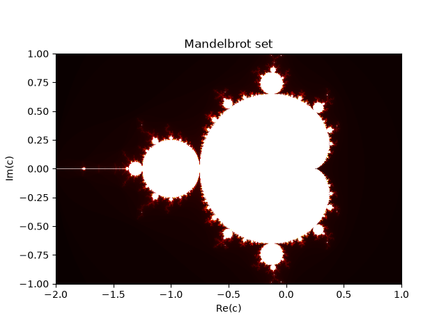

# Interfacing C and Python

## Goal

Speed up a Python program by implementing the slow part in a C library and
use Cython to enable using the C library from Python.

## Learning outcomes

- How to combine your own C code with Python
- How to pass a NumPy array to C and understand memory layout

## Background

The [Mandelbrot set](https://en.wikipedia.org/wiki/Mandelbrot_set) is computed
on a grid of complex numbers `c`. For every complex number `c`, start from
`z = 0` and repeat the mapping `z <- z^2 + c`. If `z` remains bounded when
iteratively applying this mapping, the point `c` is considered to be a member
of the Mandelbrot set. When implementing this, the mapping is applied for each
grid point until `|z|` exceeds a threshold (theory shows that if `|z|>2`, the
point will not remain bounded) or until a maximal number of iterations is
reached. The number of iterations needed is stored per grid point and plotting
a colour map gives the familiar picture:



The provided `mandelbrot.py` script does this in pure Python. While it works,
the nested loops make it slow for larger grid sizes. The goal of this exercise
is to speed up the script by rewriting the computationally intensive part in C.

## Instructions

Starting from `mandelbrot.py`, write everything needed to do the heavy computation in C:

1. Inspect and run `python mandelbrot.py`. Measure the runtime for different
   grid sizes.
2. Write a C function (and its header) that computes the number of iterations
   for every point of the grid and stores them in an array that is passed in by
   the caller.
3. Write a Cython wrapper so that the function can be called from Python,
   providing a NumPy array for filling in the number of iterations.
4. Write a `setup.py` to build the extension module (see
   `presentation/code_examples/mc_pi_python` in this repository for an example).
5. Incorporate the C library into a Python script. Compare the results and
   execution time with the original version.

## Hints

The Cython tutorial has a secion on
[how to use Cython with NumPy](https://cython-docs2.readthedocs.io/en/latest/src/tutorial/numpy.html)

A NumPy array of shape `(nx, ny)` is by default stored row by row ("C order",
also called row-major):

```
a = [[a0, a1, a2],        in memory:  a0 a1 a2 b0 b1 b2
     [b0, b1, b2]]
```

- A C function that receives a pointer to the first element, together with
  `nx` and `ny`, finds element `[i, j]` at offset `i * ny + j`.
- The array must really be contiguous in memory in this way. Slices and
  transposes of arrays are generally not.
- The data type must match the C type.

## Bonus

- Write a `Makefile` that builds the module and runs your script.
- Compare run times for increasing grid sizes.
- Zoom in on a part of the boundary of the set.
