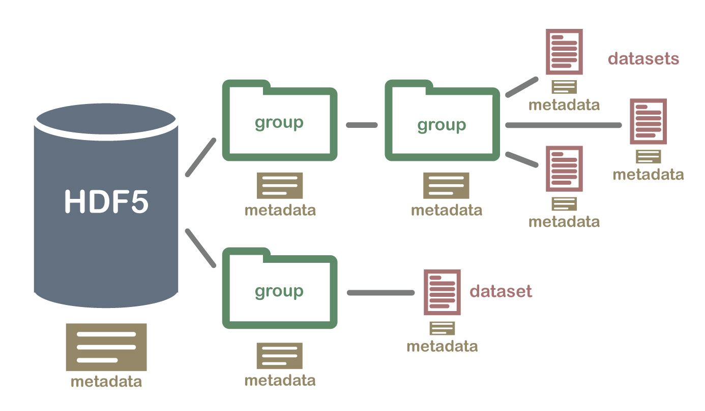



# External libraries

## External libraries

::: {.incremental}
- There are literally hundreds of potentially useful scientific libraries
- The ones discussed here are by no means exhaustive or representative for your case
- The intention is to get a feel for how you can proceed to use libraries in general
:::

## External libraries overview {.smaller}

::: {.fragment}
- External libraries extend C's capabilities — especially useful in scientific computing (e.g., linear algebra, FFT, plotting)
:::
::: {.fragment}
- Common scientific libraries:
  - **GSL** (GNU Scientific Library)
  - **BLAS/LAPACK** (Linear Algebra)
  - **FFTW** (Fast Fourier Transforms)
  - **HDF5** (Hierarchical data format)
:::
::: {.fragment}
- Benefits:
  - Avoid reinventing the wheel
  - Leverage optimized, tested code
  - Improve performance and portability
:::

## Using external libraries

- Before you can include calls to external libraries in your code, you typically need to include relevant header files
  - Header files define signatures of functions, structs, constants
- To compile code relying on an external library into an executable, you need to link that library
  - Typically `-l<libname>`, check library documentation

## Static vs Dynamic Libraries {.smaller}

| Feature              | Static Library (.a/.lib)         | Dynamic Library (.so/.dll)         |
|----------------------|----------------------------------|------------------------------------|
| Linking time         | Compile time                     | Runtime                            |
| Binary size          | Larger (library included)        | Smaller (library separate)         |
| Portability          | Easier to distribute             | Requires library on target system  |
| Updates              | Recompile to update              | Can update without recompiling     |
| Performance          | Slightly faster (no indirection) | May have overhead at runtime       |

::: {.fragment .callout-tip}
Use `gcc -static` for static linking, or `-l<libname>` with `-L<path>` for dynamic linking
:::
::: {.fragment .callout-tip}
Details differ from library to library: check the specific documentation
:::

## GNU Scientific Library {.smaller}

- The [GNU Scientific Library](https://www.gnu.org/software/gsl/) (GSL) provides a wide range of mathematical routines
- How to get it:
  - On the cluster: load it as a module, `module load GSL/2.8-GCC-13.3.0` for example
  - On your machine: install it as a system package, `apt-get install libgsl-dev` for example
- How to use it:
  - Include the relevant headers in your code
  - Find relevant link flags with `pkg-config --libs gsl` for example

::: {.callout-tip .fragment}
By loading a module on the cluster, some variables are set to make it easier to use libraries.
For instance `CPATH` will include the path of the header files, `LD_LIBRARY_PATH` will include the path of the libraries.
:::

## Minimizing a function with GSL

See [https://www.gnu.org/software/gsl/doc/html/min.html](https://www.gnu.org/software/gsl/doc/html/min.html) for documentation about one-dimensional minimization

```{.c}
#include <stdio.h>
#include <gsl/gsl_errno.h>
#include <gsl/gsl_min.h>
#include <gsl/gsl_math.h>

typedef struct {
    double a, b, sigma;
} Params;

// Define a function f according to the GSL rules
double f(double x, void *params) {
    Params *p = (Params *) params;
    return exp(-p->sigma*x*x)*sin(p->a + p->b*x);
}
```

## Minimizing a function with GSL {.smaller}

```{.c}
int main() {
    Params params = {0.3, 1.0, 0.05};

    double minimum = -2.5, lower = -3.0, upper = 0.0;
    int iter = 0, maxIter = 100, status;

    const gsl_min_fminimizer_type *T = gsl_min_fminimizer_brent;
    gsl_min_fminimizer *minimizer = gsl_min_fminimizer_alloc(T);
    gsl_function F;
    F.function = &f;
    F.params = (void *) &params;

    gsl_min_fminimizer_set(minimizer, &F, minimum, lower, upper);

    do {
        gsl_min_fminimizer_iterate(minimizer);
        lower = gsl_min_fminimizer_x_lower(minimizer);
        upper = gsl_min_fminimizer_x_upper(minimizer);
        status = gsl_min_test_interval(lower, upper, 1.0e-6, 0.0);
    } while (status == GSL_CONTINUE && ++iter < maxIter);

    if (status == GSL_SUCCESS) {
        minimum = gsl_min_fminimizer_x_minimum(minimizer);
        printf("f reached the minimum %.6f at %.6f after %d iterations\n", f(minimum, F.params), minimum, iter);
    }

    gsl_min_fminimizer_free(minimizer);
    return 0;
}
```

## BLAS: Basic Linear Algebra Subprograms

- Low-level routines for vector and matrix operations
- Levels:
  - Level 1: Vector-vector (e.g., dot product)
  - Level 2: Matrix-vector (e.g., solving triangular systems)
  - Level 3: Matrix-matrix (e.g., matrix multiplication)

## LAPACK: Linear Algebra PACKage

- Built on top of BLAS
- High-level routines for:
  - Solving linear systems
  - Eigenvalue problems
  - Singular value decomposition

## BLAS & LAPACK {.smaller}

::: {.fragment}
- Why use them?
  - Highly optimized for performance
  - Portable across platforms
  - Widely used in scientific and engineering applications
:::
::: {.fragment}
- Many implementations are available
  - OpenBLAS - Intel MKL - ATLAS
:::
::: {.fragment}
- Often implemented (partially) in Fortran and assembly
  - C bindings nearly always available though
:::

::: {.fragment .callout-tip}
Link typically happens with `-lblas -llapack`, but this can be different for optimized implementations like OpenBLAS, Intel MKL, or ATLAS.
:::

## Dot product in BLAS {.smaller}

```{.c}
#include <stdio.h>
#include <cblas.h>

int main() {
    double x[3] = {1.0, 2.0, 3.0};
    double y[3] = {4.0, 5.0, 6.0};
    double result = cblas_ddot(3, x, 1, y, 1);
    printf("Dot product: %f\n", result);
    return 0;
}
```

```{.c}
$ gcc dotproduct.c -o dotproduct -lblas && ./dotproduct
Dot product: 32.000000
```

::: {.fragment .callout-tip}
On the cluster, use `module load OpenBLAS/0.3.27-GCC-13.3.0` and link with `-lopenblas`
:::

## HDF5: Managing Scientific Data in C {.smaller}

- HDF5 (Hierarchical Data Format v5)
  - Designed for storing and organizing large, complex datasets
  - Supports n-dimensional arrays, tables, images, and metadata
  - Common in physics, climate modeling, bioinformatics, and engineering

- Features
  - Portable and self-describing binary format
  - Hierarchical structure: groups and datasets (like folders and files)
  - Supports compression, parallel I/O, and chunking

## HDF5: schematic view of an HDF5 file



## HDF5: writing a dataset

```{.c}
#include "hdf5.h"

int main() {
    hid_t file_id, dataset_id, dataspace_id;
    hsize_t dims[2] = {4, 6};
    double data[4][6] = { /* initialize with values */ };

    file_id = H5Fcreate("example.h5", H5F_ACC_TRUNC, H5P_DEFAULT, H5P_DEFAULT);
    dataspace_id = H5Screate_simple(2, dims, NULL);
    dataset_id = H5Dcreate(file_id, "/mydata", H5T_NATIVE_DOUBLE, dataspace_id,
                           H5P_DEFAULT, H5P_DEFAULT, H5P_DEFAULT);
    H5Dwrite(dataset_id, H5T_NATIVE_DOUBLE, H5S_ALL, H5S_ALL, H5P_DEFAULT, data);
    H5Dclose(dataset_id);
    H5Sclose(dataspace_id);
    H5Fclose(file_id);
    return 0;
}
```

# Exercises

## Solve a linear system of equations with GSL {.smaller}

**Goal:**

- Write a program that balances a chemical equation by solving a linear system
of equations using GSL.

**Learning outcomes:**

- Learn how to call functions in GSL.

**Instructions:**

- Consider the chemical equation $a C_3H_8 + b O_2 \leftrightarrow c CO_2 + d H_2O$.
  Write a program that determines values for a,b,c,d such that the equation is
  balanced (i.e., each element appears as often on the left-hand side as on the right-hand side). Make use of [GSL linear algebra functions](http://gnu.ist.utl.pt/software/gsl/manual/html_node/Linear-Algebra-Examples.html)
  to do this.
- Bonus: Find a way to make sure the coefficients are integers
