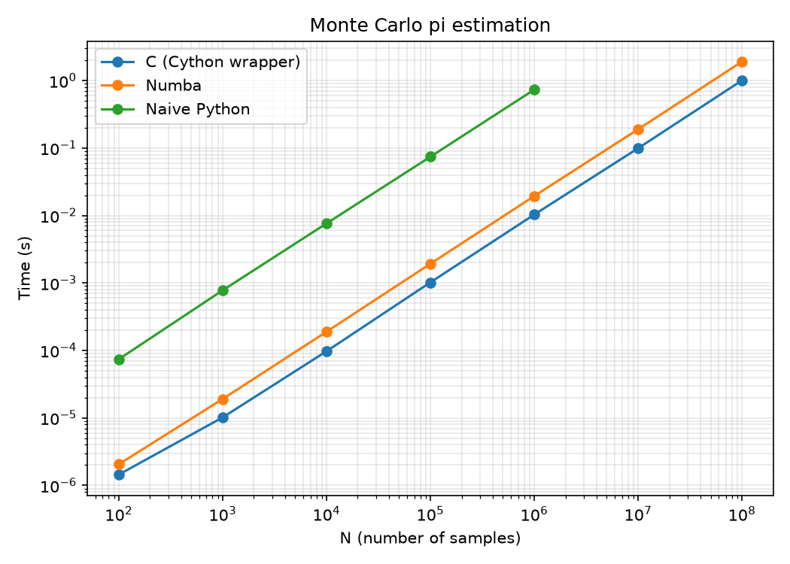
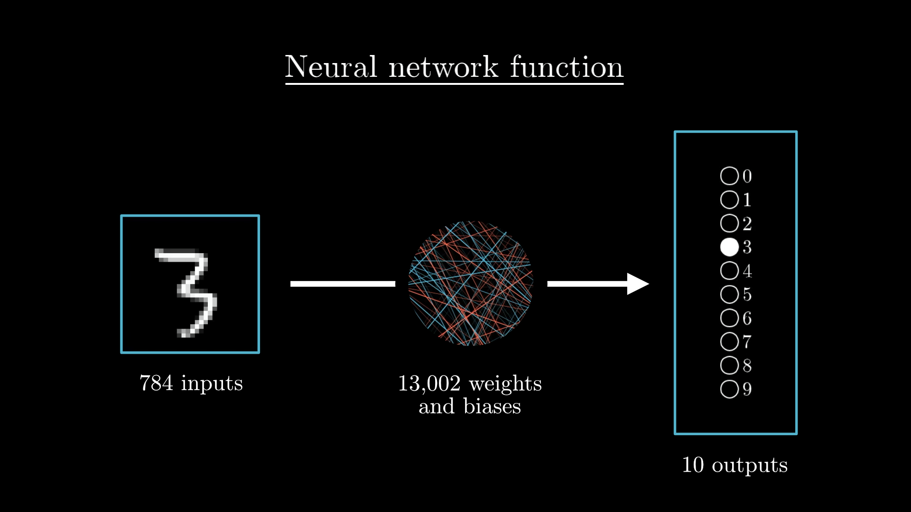
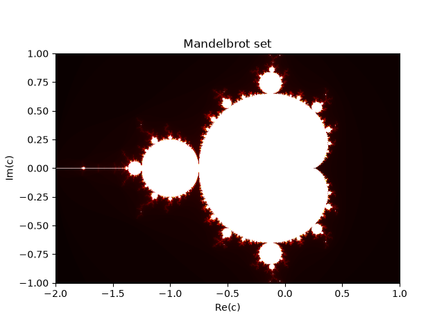

# Python bindings

## Speeding up Python

::: {.incremental}
- Python: great for prototyping, but can be slow (e.g. loops):
  - Every operation is interpreted
  - Works on generic Python objects
- C: fast, but less convenient for plotting, data analysis, ...
- Best of both worlds:
  - use Python as the "glue" code
  - do heavy computational lifting in compiled code
:::

## Options to speed up Python

- Use existing packages:
  - NumPy/SciPy: many mathematical operations with good performance
- Use a Python compiler:
  - Numba compiles Python into machine code just-in-time
- Write your own (C) library:
  - Use `ctypes` to load it into Python
  - Cython: generate bindings semi-automatically
  - pybind11, SWIG, CFFI: similar purpose as Cython

## Numba

- Numba: compiles Python to machine code (on first call)
- You add a decorator, the function body stays Python

```{.python .small-code}
from numba import jit

@jit(nopython=True)
def estimate_pi_numba(N):
    hits = 0
    for i in range(N):
        x = np.random.rand(2)
        if x[0] * x[0] + x[1] * x[1] < 1.0:
            hits += 1
    return 4.0 * hits / N
```

- Only supports a subset of Python and NumPy
- Offers automatic parallelization

## Calling C from Python

::: {.incremental}
- Implement computationally intensive functions in C
- Call from Python: requires bindings to translate
- Tools to generate or write them:
  - `ctypes`: part of the Python standard library, no compilation of bindings,
    but you declare all types by hand
  - pybind11: convenient, targets C++
  - **Cython**: a compiler that turns Python-like code into C
:::

::: {.fragment .callout-tip}
In this course we use Cython: the syntax is close to Python, and it works well with plain C.
:::

## Cython: basic philosophy

::: {.incremental}
- `.pyx` file:
  - Python syntax with C type declarations
  - `cdef extern from`: use functions from C header file
  - write a small Python function that calls the C function
- Cython: translates to C, compiles to Python extension module
- `import` the module like any other Python module
:::

::: {.fragment}
```
_mc_pi.pyx  --cython-->  _mc_pi.c  --gcc-->  _mc_pi.so
```
:::

## Cython in practice: the C code {.smaller}

We start from the Monte Carlo estimate of $\pi$ in C (`mc_pi.c`), with its header (`mc_pi.h`)

```{.c}
double estimate_pi(unsigned long N);
```

```{.c}
#include <math.h>
#include <stdlib.h>

double get_random_double() {
    // Get a random double in [0, 1]
    int x = rand();
    return (double) x / RAND_MAX;
}

double estimate_pi(unsigned long N) {
    double x, y;
    unsigned long hits = 0;

    // This can be used to seed the random number generator
    srand(0);

    for (unsigned long i = 0; i < N; i++) {
        x = get_random_double();
        y = get_random_double();
        if ( x*x + y*y < 1 ) {
            hits++;
        }
    }
    return 4.0 * hits / N;
}
```

## Cython in practice: the wrapper

`_mc_pi.pyx`:

```{.cython}
""" Example of wrapping a C function"""

# Declare the C function of interest
cdef extern from "mc_pi.h":
    # Function name for Cython followed by real C name
    double c_estimate_pi "estimate_pi"(unsigned long N)

# Function that will be visible in other Python code
def estimate_pi(unsigned long N):
    return c_estimate_pi(N)
```

::: {.fragment .callout-tip}
Python and C function share the same name, not necessarily a good practice.
:::

## Cython in practice: building

`setup.py`: describes the extension module

```{.python}
from setuptools import setup, Extension
from Cython.Build import cythonize

extensions = [
    Extension(
        "_mc_pi",
        sources=["_mc_pi.pyx", "mc_pi.c"],
    )
]

setup(ext_modules=cythonize(extensions))
```

::: {.fragment}
Build the module in the current directory:

```{.bash}
$ python setup.py build_ext -i
```
:::

## Cython in practice: using the module

```{.python}
import _mc_pi

pi = _mc_pi.estimate_pi(1000)
print(pi)
```

::: {.incremental}
- The compiled module is used like any other Python module
- Loop runs entirely in C: Python interpreter not involved
- Passing something that is not convertible to `unsigned long` (e.g. `None`) raises a `TypeError`
:::

## Comparing performance

<div style="text-align: center;"></div>

- C implementation of simple loop can be orders of magnitude faster
- Numba: competitive with C, compilation cost on first call

# Exercises

## Handwriting recognition {.smaller background-color="lightgrey"}

### Supervised machine learning models:

::: {.incremental}
- Propose a model $y = f(x; A)$ that relates the input $x$ to the output $y$ 
  with a function $f$ that depends on (currently unknown) parameters $A$
- Collect a training set of known input-output pairs of $\{x, y\}$ and
  determine the parameters $A$ such that the model predicts the expected
  outputs for the training set
  - Technically: minimize a cost function using gradient descent
- Use the estimated parameters to compute output for new inputs (inference)
:::

## Handwriting recognition {.smaller background-color="lightgrey"}

- Input $\mathbf{x}$: vector of size $784$ representing grayscale values of an image of $28 \times 28$ pixels
- Output $\mathbf{y}$: vector of size $10$, representing probabilities that image is classified as integer $\{ 0, 1, ..., 9\}$
- Model $\mathbf{y} = \sigma \left( W \mathbf{x} + \mathbf{B} \right)$
  - Perceptron: neuron whose activation depends on weights, biases and inputs
  - $\sigma$ is an activation function, in this case a softmax
- Parameters: $W$ ($784 \times 10$) matrix and $\mathbf{B}$ (vector of size 10)

::: {.fragment .callout-tip}
This is not a state-of-the-art model, but does demonstrate the essence of even very modern machine learning.
:::

## Handwriting recognition {.smaller background-color="lightgrey"}

An excellent tutorial is available at [https://www.3blue1brown.com/lessons/neural-networks](https://www.3blue1brown.com/lessons/neural-networks)
(it uses multiple layers, so more parameters than in our case)



## Handwriting recognition {.smaller}

**Instructions:**

- Use [https://github.com/AndrewCarterUK/mnist-neural-network-plain-c](https://github.com/AndrewCarterUK/mnist-neural-network-plain-c) as a
  starting point
- Go through the code and try to get a high-level overview, without getting lost in the implementation details
- Add checkpointing: allow storing parameters at the end of training in HDF5
  format. Also allow reading them back in as initial guess to resume training
- Replace the linear algebra operations by calls to BLAS. Compare the performance
  with the original implementation
- Write a companion program that does inference by using precalculated parameters
- Implement your own feature that you think would improve the code

## Handwriting recognition discussion {.smaller}

- After training for 500 epochs: accuracy for test set is about 90%
- Inference for examples outside of test set:

:::: {.columns}
::: {.column width="40%"}

:::
::: {.column width="55%"}
```{.bash}
P(0) =   0.00%
P(1) =   0.01%
P(2) =   0.11%
P(3) =  99.81%
P(4) =   0.00%
P(5) =   0.02%
P(6) =   0.00%
P(7) =   0.00%
P(8) =   0.05%
P(9) =   0.00%
Digit prediction: 3
```
:::
::::

## Handwriting recognition discussion {.smaller}

- After training for 500 epochs: accuracy for test set is about 90%
- Inference for examples outside of test set:

:::: {.columns}
::: {.column width="40%"}

:::
::: {.column width="55%"}
```{.bash}
P(0) =   0.05%
P(1) =   0.00%
P(2) =   0.01%
P(3) =  96.88%
P(4) =   0.00%
P(5) =   3.06%
P(6) =   0.00%
P(7) =   0.00%
P(8) =   0.00%
P(9) =   0.00%
Digit prediction: 3
```
:::
::::

## Handwriting recognition discussion {.smaller}

- After training for 500 epochs: accuracy for test set is about 90%
- Inference for examples outside of test set:

:::: {.columns}
::: {.column width="40%"}

:::
::: {.column width="55%"}
```{.bash}
P(0) =   0.00%
P(1) =   0.08%
P(2) =   0.68%
P(3) =   0.01%
P(4) =   0.00%
P(5) =   0.00%
P(6) =  99.08%
P(7) =   0.00%
P(8) =   0.14%
P(9) =   0.00%
Digit prediction: 6
```
:::
::::

## Mandelbrot set in C {.smaller}

**Goal:**

- Speed up a Python program that computes the Mandelbrot set by moving the
  heavy loop to C, and calling it from Python with Cython.

**Learning outcomes:**

- Combine what you learned about C and Cython in a new problem.
- Learn how to find out how to pass a NumPy array to C by reading documentation.
- Learn how a 2D array looks like from the C side.

**Instructions:**

- Run `mandelbrot.py`, look at the result and note how long it takes.
- Write a C function that computes the number of iterations for each point of the grid and stores them in an array.
- Write a Cython wrapper, a `setup.py` and a Python script that calls the function with a NumPy array
- Compare the result and the run time with the pure Python version.
- Bonus: Write a `Makefile`, and compare run times for increasing grid sizes.

## Mandelbrot set {.smaller background-color="lightgrey"}

For every point $c$ on a grid in the complex plane:

::: {.incremental}
- Start from $z_0 = 0$ and repeat $z_{n+1} = z_n^2 + c$
- Stop when $|z_n|$ exceeds a threshold (the point diverges) or when the maximal number of iterations is reached
- Store the number of iterations for that grid point
:::

::: {.fragment}
Plotting the number of iterations gives the Mandelbrot set:

{width=45%}
:::

## Mandelbrot set: hints {.smaller background-color="lightgrey"}

**Where to find information**

- The Cython documentation on typed memoryviews explains how to work with NumPy arrays in Cython, including how to pass them to a C function: [https://docs.cython.org/en/latest/src/userguide/memoryviews.html](https://docs.cython.org/en/latest/src/userguide/memoryviews.html)
- The `mc_pi` example is a good starting point for the wrapper and for `setup.py`

**Memory layout**

A NumPy array of shape $(n_x, n_y)$ is stored row by row (C order):

```
a = [[a0, a1, a2],        in memory:  a0 a1 a2 b0 b1 b2
     [b0, b1, b2]]
```

::: {.incremental}
- C only receives a pointer to the first element and the sizes: element `[i, j]` is at offset `i * ny + j`
- The array must be contiguous in memory like this
- The data type must match
:::
